# DietBet 产品图鉴

> 对标拆解。来源：DietBet 官网全站抓取（2026-11-15）+ App Store 官方截图 + iTunes Lookup API。
>
> 配图目录：`../素材/配图/DietBet/`
> - `web-*.png` —— 官网页面全页截图
> - `app-*.jpg` —— App Store 官方 iPhone 截图
> - `ipad-*.jpg` —— App Store 官方 iPad 截图

---

## 零、这个产品是什么

| 项 | 值 |
|---|---|
| 官网 | dietbet.com |
| App | [DietBet: Lose Weight & Win!](https://apps.apple.com/us/app/dietbet-lose-weight-win/id532353287) |
| 开发者 | FitnessAI Inc. |
| 上线 | 2012-06-20（已 14 年） |
| 当前版本 | 27.3.0（2026-10-08） |
| 商店评分 | 4.77 / 5，**20,574 个评分** |
| 下载量 | 935,585+ |
| 分类 | Health & Fitness / Games |
| 分级 | 18+ / 17+（含 Gambling 广告分级） |
| 运营方 | Appex Group, Inc.（2025 年收购，原 WayBetter） |
| 官方口径 | 1,039,224 玩家 · 20,378,592 lbs 减重 · $101,121,996 已付给赢家 |

**关键事实：这个产品在中国被主动封禁。**
Terms of Use 第 19 条：
> 「any awards won or amounts lost from users or players of any games from the Site in such jurisdiction **need not be honored by the Company**」

FAQ 明确列了「DietBet availability changes in your country」章节。所以它是**零件参考，不是竞品**。

---

## 一、页面清单（共 12 个）

### 页面 1｜首页 Home

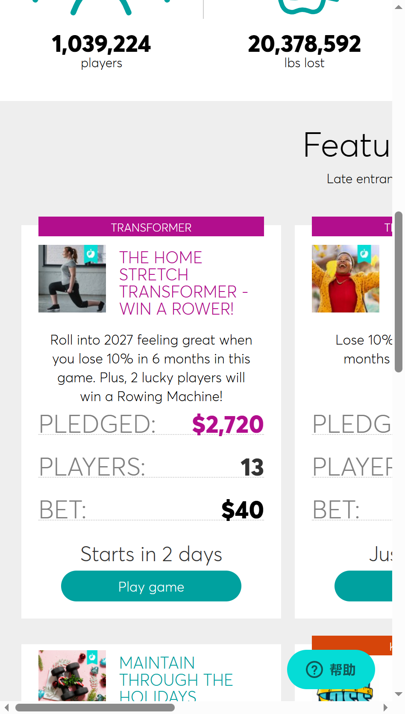

**URL**：`https://www.dietbet.com/`

**结构（自上而下）**

| 区块 | 内容 |
|---|---|
| 顶部导航 | Logo · Sign In |
| Hero 主视觉 | `Want to lose 10%?` + 「Join our Weekly Transformer DietBet / Starts in 2 days」+ 一个真实案例缩略（Lost 56 lbs / Won $2,200）+ 免责「Individual results may vary.」 |
| Hero 第二入口 | `WANT TO LOSE 4%?` → Join our Weekly Kickstarter |
| Hero 第三入口 | `HOST A DIETBET` → Start a DietBet with your friends and family! |
| **How it Works 三段图** | Join the game → `1,039,224 players` / Lose Weight → `20,378,592 lbs lost` / Win and split the pot → `$101,121,996 paid to winners` |
| Featured Games | 4 张对局卡片 + 提示「Late entrants permitted until day 14.」+ See all games |
| Success Stories | 12 个案例轮播 + VIEW ALL STORIES |
| 口碑区 | "People are talking" + Twitter 嵌入 |
| App 下载 | iOS / Android 二维码 |
| 页脚 | Privacy · Facebook · Terms of Use · Twitter · How It Works · Instagram · Rules · FAQ · Create Game |

**可抄的 8 个点**

1. **Hero 用提问不用产品名** —— `Want to lose 10%?` 直接问目标
2. **三段式流程 + 三个大数字** —— 每个流程步骤下方挂一个社会证明数字
3. **双入口并列** —— `Play now`（消耗现有供给）排在 `Or, create your own game!`（制造新供给）**前面**
4. **卡片固定字段** —— `Pot / Players / Bet` 三字段 + 状态标签（Starts in 2 days / Just Started）
5. **"Late entrants permitted until day 14." 印在卡片区顶部** —— 把加入窗口期当卖点
6. **案例模板** —— `Lost X lbs` + `Won $Y` + **一句金句** + 长文本 + 免责
8. **注册表单极简 + 隐私承诺前置** —— 名/姓/邮箱/密码 + 4 位邮箱验证码 + 「We'll never post anything without your permission.」

**金句（可直接当 slogan 的种子）**
> "I loved the motivation from the other players, **it wasn't about the money**"
> "**Losing is not an option. I am betting against myself.**"
> "I thrive on competition and deadlines."
> "Why not get paid to lose weight?"

---

### 页面 2｜How It Works 玩法说明

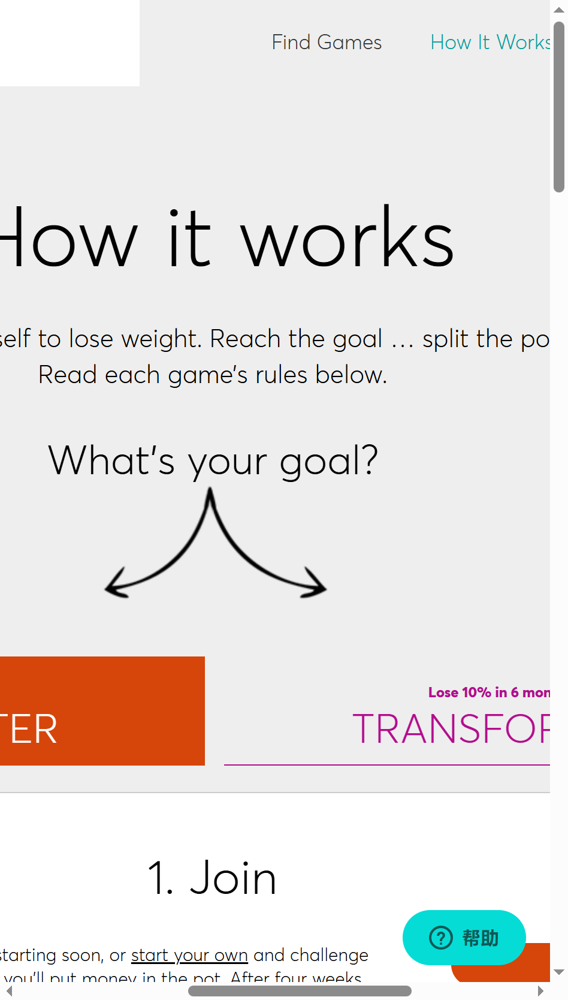

**URL**：`https://www.dietbet.com/kickstarter/how-it-works`

**五步流程（这是整个产品的骨架）**

| 步骤 | 标题 | 内容 |
|---|---|---|
| 1 | **Join** | Try it risk-free! / Money back guarantee |
| 2 | **Weigh-In** | 开局前 2 天提示提交起始体重。标准流程是提交 **2 张照片**：一张站在秤上的全身照（轻装），一张秤读数特写。**What you'll need**：A scale (preferably digital) / A digital camera or smartphone / A full-length mirror or someone to take your photo。附 Privacy FAQ + How we prevent cheating 折叠链接 |
| 3 | **Play** | DietBet on-the-go!（App 下载） |
| 4 | **Weigh-Out** | 最后一天后 **48 小时**窗口提交最终体重。**没赢也要交** —— "Even if you have not won, please enter your final weight." 不需要照片验证除非被要求 |
| 5 | **Win!** | 24 小时内出结果，池子扣除手续费后分给赢家。附 **No Lose Guarantee**：如果赢家比例异常高，平台放弃自己的抽成 |

**Compare Games 对比表（页面底部）**

| | KICKSTARTER | TRANSFORMER |
|---|---|---|
| 定位 | LOSE A LITTLE | LOSE A LOT |
| 时长 | 4 weeks | 6 months |
| 目标 | Lose 4% of body weight | Lose 10% of body weight |
| 实际减重 | Winners lose 9.4 lbs on average | Winners lose 25.8 lbs on average |
| 押注 | $35 on average | $35/month or $175 paid upfront |

**可抄的点**
- **"What you'll need" 清单** —— 提交前把要准备什么列出来，降低心理门槛
- **"Even if you have not won, please enter your final weight."** —— 失败也要走完流程，让数据完整
- **No Lose Guarantee** —— 赢家太多时平台让利，极度反向思考
- **对比表选维度**：时长 / 目标 / 实际效果 / 代价 —— 「实际减重」这一栏是转化利器

---

### 页面 3｜Game Directory 对局目录

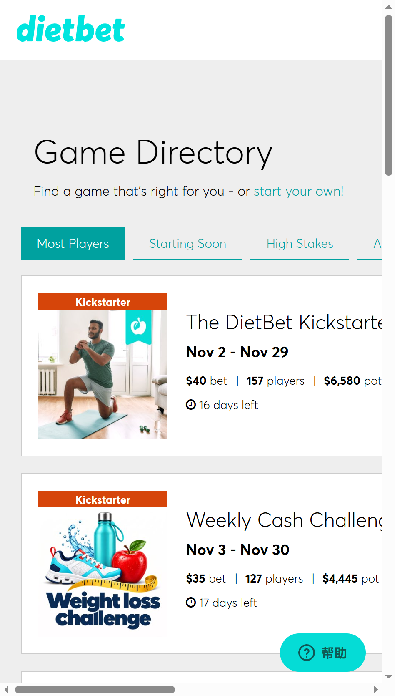

**URL**：`https://www.dietbet.com/games`

**结构**
- 搜索框：`Search for a game...`
- **快捷排序 Tab**：Most Players / Starting Soon / High Stakes / All
- **Filter 抽屉**（右侧展开）：**Bet Size**（金额区间）· **Game Type**（Kickstarter / Transformer / Maintainer）· **Game Status**（Starting Soon / Just Started / Closed / Ended / Invite-Only）
- 对局卡片列表
- 底部：`Start your own` CTA

**可抄的点**
1. **筛选维度分三类**：规模（人数）· 时间（状态）· 钱（赌注）· 类型。**状态是唯一一个"钱无关"但极重要的维度**
2. **Game Status 里的 `Invite-Only`** —— 私密局是独立筛选维度，暗示"我的私密圈"也是产品的一部分
3. **High Stakes 单独一个 Tab** —— 制造"高风险高回报"的冲动
4. **搜索 + 筛选 + 排序三层** —— 你的「广场」需要同样的三层结构

---

### 页面 4｜对局详情页 Game Detail

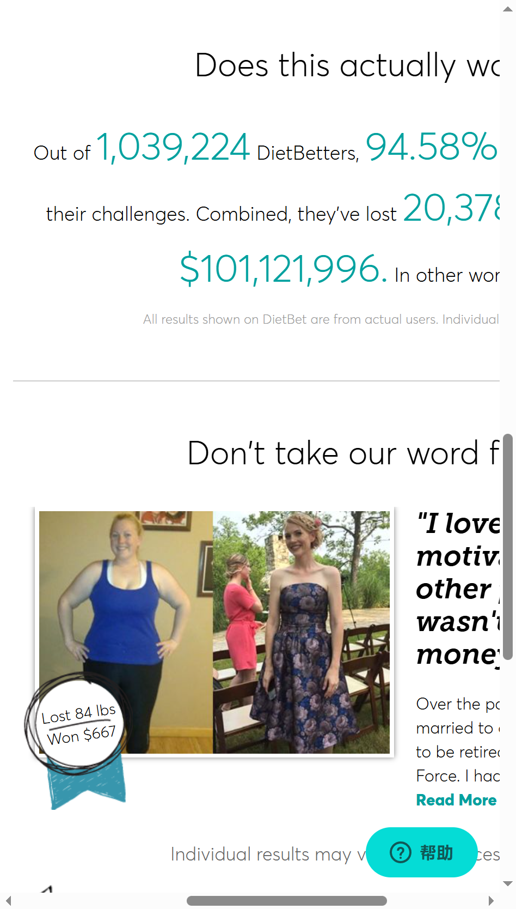

**URL**：`https://www.dietbet.com/games/{id}`（示例 `/games/97206` "Vacation Burn"）

**结构**

| 区块 | 内容 |
|---|---|
| **顶部数字条** | `$50 BET` / `3 PLAYERS` / `$150 POT` / `May 27 START DATE` —— 四个并列数字 |
| 保障条 | `GUARANTEE` → 7-day Money Back |
| **重要日期轴** | Game Begins: May 27 → Last Day to Join: Jun 09 → Final Weigh-In: Jun 24–25 → See full set of rules › |
| Tab 切换 | HOW IT WORKS / ACTIVITY |
| 玩法三连 | `Bet $50` to start → `Lose 4%` in 4 weeks → `Win!` Split the pot |
| 称重说明 | 双照片 + What you'll need + Privacy FAQ + How we prevent cheating |
| 效果背书 | "Out of 1,039,224 DietBetters, **94.58% have lost weight** during their challenges. Combined, they've lost 20,378,592 lbs and won $101,121,996. In other words...**yes.**" |
| 案例轮播 | 同首页 |
| Activity Tab | 未登录时显示 **"Join this game to see the activity feed."** + `Ready to bet on yourself?` CTA |

**可抄的点**
1. **顶部四数字条** —— 你的对应：`押金金额 / 见证人数 / 围观人数 / 起始日`
2. **日期轴是页面的骨架** —— 开始 / 截止加入 / 最终称重 / 规则。不是藏在 FAQ 里
3. **94.58% 有效率数字** —— 用真实数据（不是"我们能帮你"）来消除怀疑
4. **Activity Feed 设为登录后可见** —— 制造 FOMO，且"围观"本身成为加入的理由
5. **玩法三连的中间用动词+数字** —— `Bet $50` → `Lose 4%` → `Win!`

---

### 页面 5｜Testimonials 成功案例

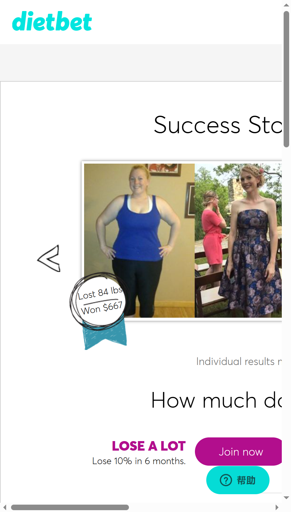

**URL**：`https://www.dietbet.com/testimonials`

**结构**
- 顶部 12 个案例大轮播（编号 + 姓名 + Lost X lbs + Won $Y + 金句 + 长文本）
- **中段「How much do you want to lose?」** —— 又一次双入口（LOSE A LOT → 10% in 6 months / LOSE A LITTLE → 4% in 4 weeks）
- **「Success Stories」区** —— 6 条金句 + 署名（-Margaret / -Kate / -Matthew / -Mikele / -Jo / -Robert）
- 免责：`Individual results may vary from Success Stories.`
- 底部又是双入口

**可抄的点**
1. **案例分两处用**：完整案例（长文本）和金句墙（纯引用）—— 金句墙适合做分享物料
2. **每个案例都带金额** —— 既是结果证明也是转化钩子
3. **同一套双入口在一页里出现两次** —— 反复推 CTA

---

### 页面 6｜Kickstarter Rules 规则页

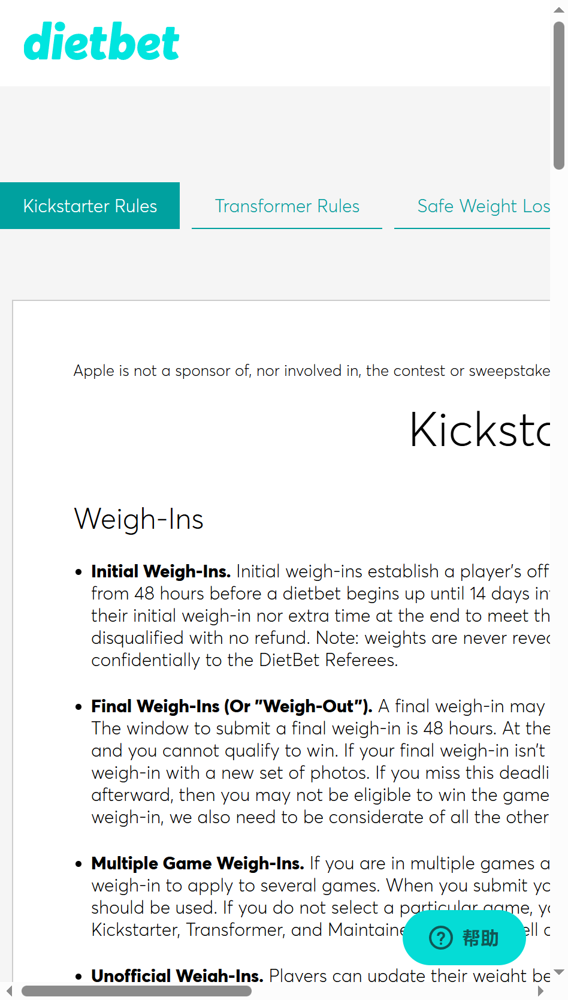

**URL**：`https://www.dietbet.com/kickstarter/rules`

> ⚠️ **这是全站信息密度最高的页面，也是我们要抄最多的页面。**

#### Weigh-Ins 称重机制

| 条目 | 规则 |
|---|---|
| **Initial Weigh-Ins** | 开局前 **48 小时**起，到开局后 **14 天**止。未提交 → **取消资格且不退款** |
| **Final Weigh-Ins (Weigh-Out)** | 对局结束后次日 00:01 PT 起，窗口 **48 小时**。未通过裁判审核 → 有 **12 小时**重新提交（需新照片）。仍不通过 → 可能失去获胜资格 |
| **Multiple Game Weigh-Ins** | 48 小时内一次称重可复用于多个对局 |
| **Unofficial Weigh-Ins** | 官方称重之间可自由更新体重，无需验证。**官方建议每 4 天更新一次** |
| **Photo-Based Proof** | 两张照片：① 全身站秤照（轻装：no shoes/hats/belts/watches/coats/outerwear，口袋掏空，正脸清晰）② 秤读数特写 + **手写 weigh-in word**（随机词，作时间戳防照片复用） |
| **Auditing** | 随机抽查 + 算法检测异常减重。被标记 → 必须提交**视频称重**，直到裁判解除标记。不配合 → 取消资格 + 没收已赢奖金 + 禁赛。**押金超过 $100 的对局，所有人强制视频称重** |
| **Dress Code** | 官方称重与最终称重必须穿**基本等价的衣服**，裁判**并排比对**称重照与称出照 |
| **Scales** | 尽量用同一台秤。数字秤或体重秤，放在硬平地面。**模拟秤允许但显著提高被审计概率** |
| **单位** | 可选 kg / lb，系统自动统一计算 |

#### Refunds 退款
> 「Players have up until **day 7 of the game** to receive a full refund. Please note that the 7 day period begins on **the day the game starts and not the day the player joins**.」

#### Winnings 胜负判定
- **Goal Weight** = 官方核准的起始体重 **减去 4%**（不是用户填的）
- **Winning** = 体重 ≤ Goal Weight 即算赢，**除非**：
  - 总减重 ≥ 目标差值的 3 倍（即减重 ≥ **12%**）
  - 被举办方或 DietBet 除名
- **Disputes**：`Decisions by the DietBet Referees shall be final.` —— **终局，不可申诉**
- 结算通常在对局结束后再花 **3 天**（周末节假日更久）

#### Unsafe and Unsportsmanlike Behavior 健康红线
- **Age**：≥ 18 岁
- **BMI**：必须 ≥ **18.5**（初始称重时提供身高）。若减到 Goal Weight 会低于 18.5 → 不能参赛
- **禁止行为**（被抓即除名，不退款）：
  - Binging or hydration（暴食或灌水）
  - Purging（自催吐）
  - Excessive dehydration（过度脱水）
  - Engaging in weight-loss medical procedures（减重手术/药物）
  - Tampering with the measurement reported by the scale（篡改秤读数）

#### Sportsmanship 文明条款（← 直接对应我们的"零评论"设计）
- No intentionally misrepresenting one's weight
- No playing in bad faith（hustling）
- **No colluding** / 不得对赌自己没参与的局 / 不得赌别人输
- **No harassment of players**
- **No embarrassment of players**
- **No disclosing confidential information such as the weight of a player**
- No posting photos without permission
- No gaming the system（多账号、伪造称重照）
- **No business, product or self promotion posts**
- **No nudity**

#### Definitions 术语表（11 个）
DietBet · Kickstarter · Organizer · Hosted DietBet · Private DietBet · Open-Access DietBet · **Referee** · Bet · Pot · Unofficial Weigh-In · Official Weigh-In · Lightweight clothing

> **Referee =「an agent of DietBet」—— 裁判是平台雇员，不是用户兼任。**

---

### 页面 7｜Transformer Rules 六个月规则

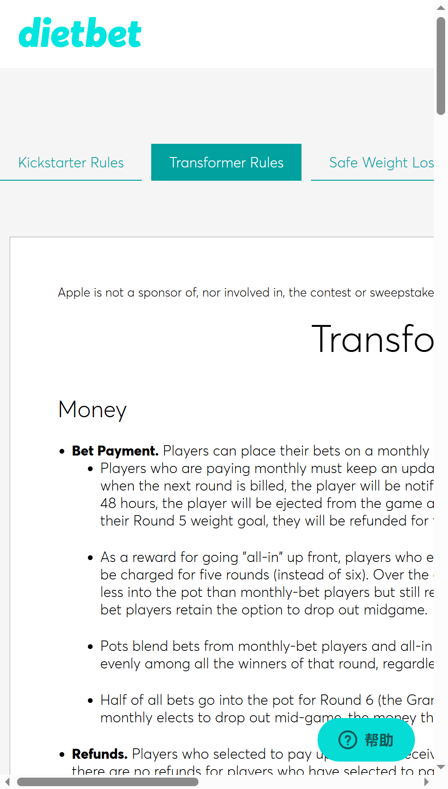

**URL**：`https://www.dietbet.com/transformer/rules`

#### Money 付费结构
- **Bet Payment**：可月付或一次性付。一次性付六期 = **只收五期的钱**（第 6 期免费）
- 两种付费方式的池子**混合**，每轮结算时池子按当轮赢家**均分**，不看付费方式
- **一半**的押金进入 **Round 6 大奖池**，另一半进 Round 1–5
- **Refunds**：一次性付的可在 Round 1 的第 14 天前全退；月付的随时可退出，不扣未玩轮次
- **Payouts**：每轮赢的金额**累积**，比赛结束后一次提现

#### 六轮里程碑（累计减重）

| 轮次 | 目标 | 取消资格线 |
|---|---|---|
| Round 1 | 3% | 12% |
| Round 2 | 6% | 18% |
| Round 3 | 8% | 24% |
| Round 4 | 9% | 27% |
| Round 5 | 10%（**强制称重**） | 30% |
| Round 6 | 10% | 30% |

> **Round 5 是强制称重点**，且**必须到 Round 5 结束至少减 6%**才能进 Round 6（防止最后冲刺）。
> **漏一轮不直接出局** —— 只丢当轮，但仍可赢后续轮次和最终大奖。

#### 额外禁止行为（相对 Kickstarter 多两条）
- **Doctoring weigh-in photos**（伪造/修图称重照）

---

### 页面 8｜Safe Weight Loss 安全减重指南

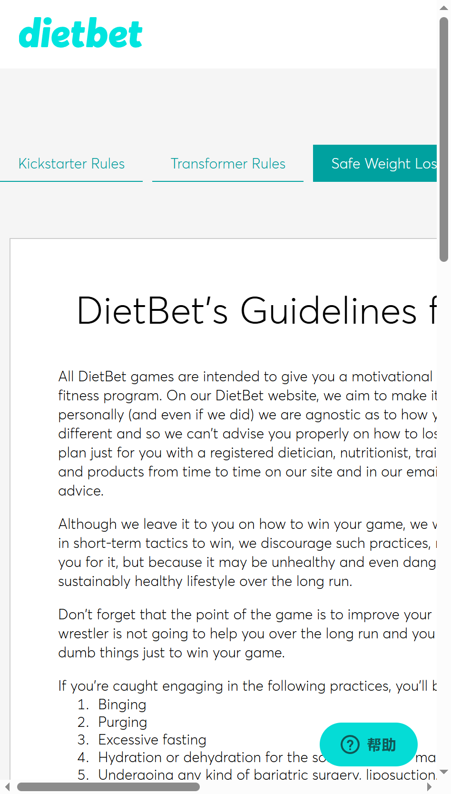

**URL**：`https://www.dietbet.com/safe-weight-loss-rules`

> 页面 Title 显示为 "Maintainer Challenge Rules"，但内容是安全减重指南 —— 站点自身的路由 bug。

**核心声明**
> 「All DietBet games are intended to give you a **motivational boost**, but they do **not serve as a weight-loss, health, wellness, or fitness program**.」

**会被取消资格的 5 种行为**
Binging · Purging · Excessive fasting · 为操控体重而喝水/脱水 · 任何减重手术、抽脂或其他减重程序

**健康减重项目应该包含**（引用美国 HHS）
- 不排除特定食物组的健康饮食计划
- 规律身体活动
- 考虑文化需求的健康行为改变建议
- 缓慢稳定的减重
- 特殊配方饮食需医疗照护
- 减重后的维持计划

**附「加入减重项目前要问的 8 个问题」** —— 安全性、咨询能力、人员资质、应激应对、维持期、食物灵活性、完成率、平均减重、1/2/5 年维持率、副作用率、额外费用。

---

### 页面 9｜FAQ 常见问题

**URL**：`https://www.dietbet.com/faq`

**四大板块**

**General（14 问）**
1. 为什么要试？→ 96% 玩家减重成功；基于 UPenn、Brown Medical Center、Mayo Clinic 原则；曾获 Obesity Society eHealth 奖
2. 怎么验证减重？→ 双照片 + 裁判人工审核
3. 作弊容易吗？→ 随机词防照片复用 + 人工审核 + 算法标记异常 + **零容忍**（作弊 → 除名不退 + 永久禁赛）+ 99% 玩家是认真的
4. 什么是视频称重？→ 需用数字秤 + 朋友拍摄；先全身站秤（正脸清晰）→ 拉近到秤和 weigh-in word
5. 两种对局怎么选？
6. 能同时参加多个吗？→ **最多 3 个 Kickstarter + 3 个 Transformer**
7. 一次称重能用于多个对局吗？→ 48 小时内可复用
8. 这是比赛吗？→ 「compete against themselves, not each other」+ 社区支持
9. Activity feed 是干嘛的？→ 中央枢纽，发自拍、找食谱、接设备（RunKeeper / MapMyFitness / Jawbone / Withings / Fitbit）
10. **我的体重公开吗？→ 称重照片 100% 私密绝不分享；体重默认仅自己可见，需主动开启公开**
11. **我在其他国家能玩吗？** → 能。自动按汇率折算当地货币。可选公制单位。**唯一差异是不寄实物奖品，改为折算成账户余额**
12. 什么情况下取消资格？→ 骚扰他人 / 谎报体重 / 超最大减重阈值 / 未在 14 天窗口提交初始称重 / 未提交最终称重。**取消资格不退款**
13. 如何防止不健康减重？→ BMI < 18.5 不能参加；每个对局有最大减重上限

**Money（5 问）**
1. 为什么没有免费对局？→ 与 Brown Medical School 合作研究财务激励，**「the idea of losing money is what will push you to really lose the weight」**（关键洞察：输钱的心理 > 赢钱）
2. 能赢多少？→ 取决于池子大小和赢家数量
3. 怎么拿钱？→ Points 兑换现金，需 PayPal 或其他平台认可的支付账户，**账户名必须与 DietBet 账号名一致**，需上传与两者同名的政府 ID。**无最低提现额**，但 < $50 加收 $5 手续费
4. 中途退出能退吗？→ Kickstarter：开局后 7 天内可全退；Transformer：一次性付的 Round 1 第 14 天前可退，月付的退首月。**医疗原因可例外，需提供证明**。**对局结束后一律不退**
5. **平台抽多少？** → 「**10–25% of the pot**，取决于初始押注额。抽成在分配给赢家之前扣除，**输的人不承担手续费**」

**Hosting a Game（3 问）**
1. 怎么创建？→ Create 按钮 → 设开始日期、类型、押注额 → **至少 2 人**才能开
2. 只和朋友玩？→ 选 `Invite-Only`
3. 怎么让对局更精彩？→ 发起人发话题、办抽奖、公开自己的进展、设周/月日历

**Kickstarter / Transformer / Maintainer / Membership 各自规则**
- **Maintainer**：会员专属，12 个月维持体重，**±3% 容差**，赢家**分 100% 池子**（会员独占）
- **Transformer 里程碑**：3% / 6% / 8% / 9% / 10% / 10%
- **Membership 特权**：每周 verified Progress Weigh-in（**周三 23:59 PT 截止，周四重置**）+ 每周 Progress Prize 抽奖 + 每周目标日记 + 个性化裁判反馈
- **会员价格**：可 30 天免费试用，之后自动续订；**取消无部分退款**；前 7 天可申请退款

---

### 页面 10｜Terms of Use 服务条款

**URL**：`https://www.dietbet.com/terms`（Last Revised: 2025-04-23）

**结构**：22 条 + 会员条款 + Code of Conduct + 反作弊条款

**对设计最关键的 5 条**

**第 10 条**：「Fees include direct fees as well as a percentage of the payouts.」

**第 11 条 6：不是抽奖游戏**
> 「DietBet games are **not games of chance**. The intent of the program is to reward participants only for actions over which they can control or influence.」
> ⚠️ 这条极其重要 —— **是"技术/行为"不是"运气"**，是它能绕开博彩监管的核心论证。**我们的产品必须照抄这个论证结构。**

**第 15 条**：责任上限 = 用户支付额，且 **≤ $1,000**；「**THE COMPANY PARTIES SHALL BEAR NO LIABILITY FOR ANY AMOUNTS LOST THROUGH A BET**」

**第 18 条**：强制仲裁（Boston, MA，AAA）+ 放弃集体诉讼 + 放弃陪审团

**第 19 条 Prohibited Use**：
> 「The use of the Site where prohibited by law is not permitted; any use in such jurisdiction is strictly prohibited and **any awards won or amounts lost... need not be honored by the Company**」

---

### 页面 11｜Privacy Policy 隐私政策

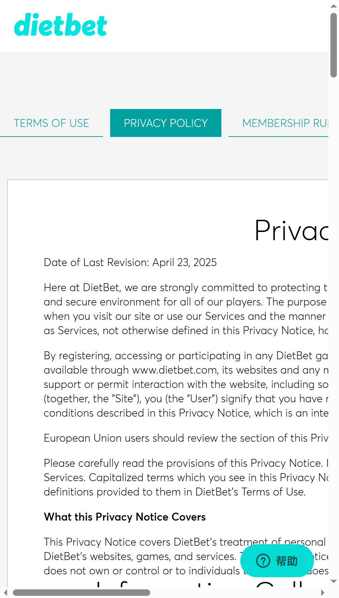

**URL**：`https://www.dietbet.com/privacy`（Last Revised: 2025-04-23）

**结构**：23 个小节

**收集的信息分类**
1. 注册信息（含身高）
2. 用户/玩家资料（User Profile）
3. **支付信息 ——「uses PCI-compliant payment processors and does not itself see or store your credit card details」**
4. **邀请好友** —— 可指定朋友/同事/「accountability partner」/队友
5. **对局提交内容** —— 照片、视频、**「potentially sensitive health-related content」**
6. **位置信息** —— 可选退出
7. **自动信息** —— 「weight, steps, or other of your activity」
8. **⚠️ 用用户提交物做研究和训练 AI**
   > 「DietBet may use photos, videos, and other user submissions for **research and development purposes, including to train artificial intelligence**」——**这句在我们这里是绝对红线，不能抄**
9. 经明确同意可访问通讯录

**其他关键节**
- **健康信息 / HIPAA**：披露健康状况时可**明确选择**让持牌医疗提供者联系；同意书要写明「被披露的信息、谁会联系、目的」；**No Surprise Contact**；可随时撤回同意；合作方受 HIPAA 约束
- **未成年人**：18 岁以下禁止注册，不主动收集，发现即删
- **账户与数据删除**：可要求访问、更正、删除；删除账户请求 **15 个工作日**内响应
- **公开信息**：「DietBet will allow third parties access to all DietBet data that is already publicly available... DietBet will keep passwords private.」
- **安全**：密码保护 + 一般公认的行业标准

---

### 页面 12｜App 官方截图（iPhone + iPad）

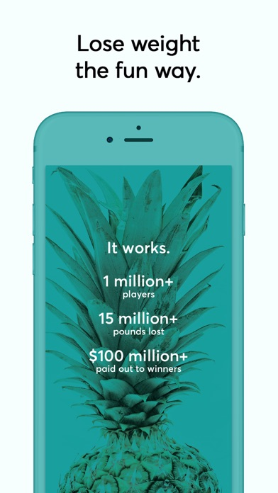
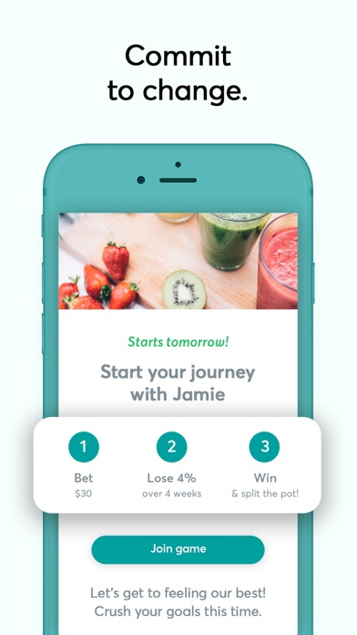
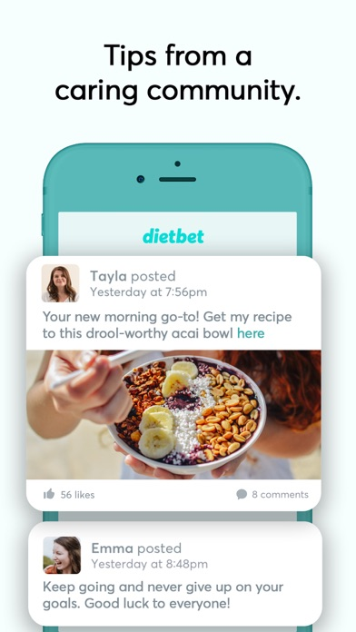
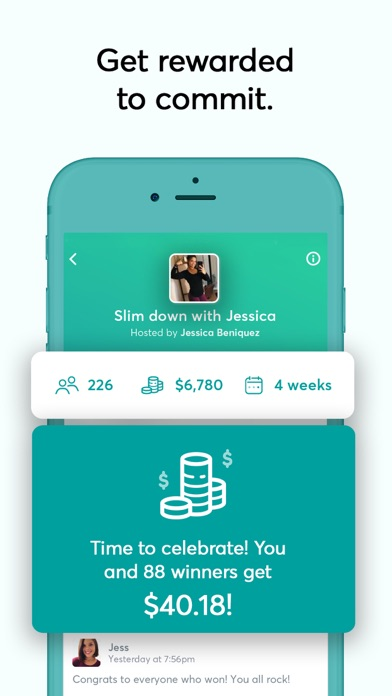
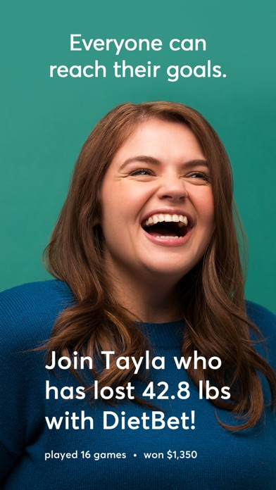
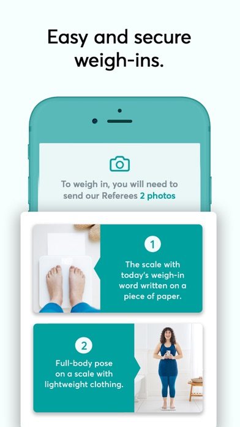

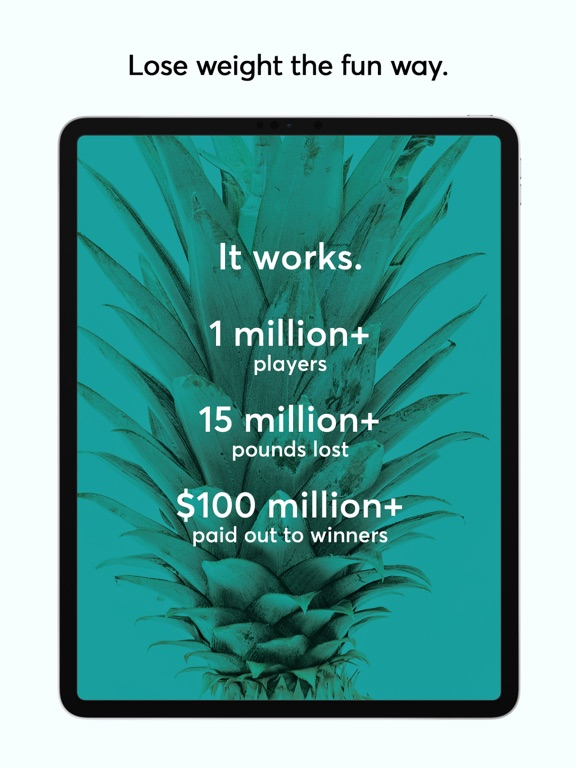
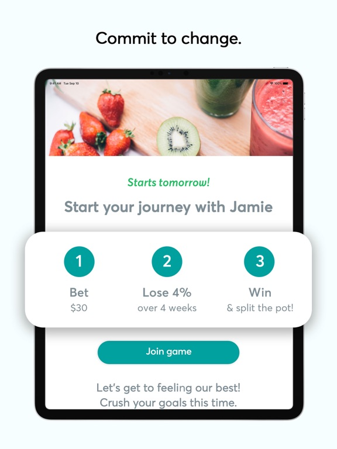
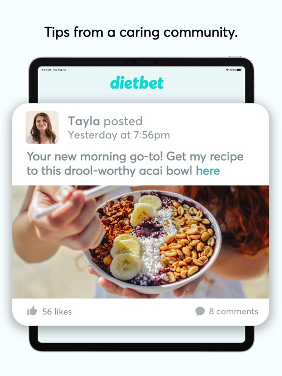
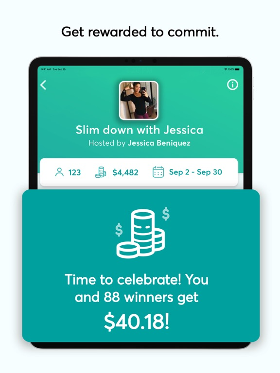

**从 App 截图能读出的信息**

| 观察 | 说明 |
|---|---|
| **底部 Tab 结构** | DietBet App 采用多 Tab 布局（Home / Games / Activity / Account），Account 在**最右侧**（据官方 FAQ：「you will see them under your Account (bottom right tab) > Past games」） |
| **Onboarding 是 4 步引导** | App Store 描述的四步：Download → Join a game by placing a pledge → Hit goals and weigh in regularly → Win back your pledge plus more |
| **官方自称"有真人客服"** | 「receive customer service from **real people**」—— 裁判是雇来的，不是用户 |
| **App 商店描述里的角色分工** | 「Play games **hosted by experts**, including pro fitness trainers, nutritionists and wellness gurus」—— **有专业主持人（host）** |
| **iPad 版单独设计** | 有 4 张 iPad 专属截图，说明认真做过平板布局 → **我们的 App 也应该做 iPad 适配**，不要只做手机 |

---

## 二、抄 / 不抄 总表

### ✅ 直接抄（零合规风险）

| # | 机制 | 我们的落地 |
|---|---|---|
| 1 | Hero 三数字社会证明 | `12,847 人正在立 Flag` / `累计减重 3,420 kg` / `已发出见证荣誉 2.1 万` |
| 2 | 提问式主标题 | 「你还能穿回那件衣服吗？」 |
| 3 | 双入口并列（加入现有 / 自建） | 广场首屏两个大按钮 |
| 4 | 卡片固定字段 | `围观人数 / 见证人数 / 押金金额` + 状态标签 |
| 5 | 加入窗口期印在卡片区 | 「中途加入可参与见证，截止日 X」 |
| 6 | 案例模板 + 金句 + 免责 | **记录卡**模板（过程记录，非战绩） |
| 8 | 日期轴显性化 | 开始 / 截止加入 / 最终称重 / 规则，四个节点 |
| 9 | **94.58% 有效率数据背书** | 用真实数据证明有效 |
| 10 | **What you'll need 清单** | 提交物证前列出要准备什么 |
| 11 | **失败也要走完流程** | 失败也要提交最终状态 → **未达标照样出记录卡** |
| 12 | **三层筛选**（状态/类型/规模） | 广场筛选抽屉 |
| 13 | **筛选器把"状态"和"规模"独立成维度** | 不只按金额筛 |
| 14 | **隐私承诺前置到注册页** | 「未经你同意绝不公开你的体重和照片」 |
| 15 | **称重照 100% 私密** | 物证照片永不公开，只有裁决结果公开 |
| 16 | **随机词时间戳机制** | 中文短词库（笔画少、适合 OCR） |
| 17 | **体重默认私密，需主动公开** | 公开是 opt-in |
| 18 | **12 小时补交窗口** | 物证审核不通过可重传 → **AI 判负的 12 小时视频自证通道** |
| 19 | **"不是游戏运气，是可控行为"论证** | 合规叙事核心，必须照抄 |
| 20 | **初始称重窗口宽松（14 天）** | 降低开局流失 |
| 21 | **称重核验只在 2–3 次**（初始/最终/强制） | **见证席节点制（按周期 2–4 次）** —— 日常打卡双方零动作 |
| 22 | **"Referee is an agent of DietBet"** | 换成 **AI 裁判 + 人工兜底**，判负必人工 |

### 🔶 抄结构，换载体

| # | 原机制 | 我们的改造 |
|---|---|---|
| 1 | 两段式押金（一次性 / 月付） | 一次性押金 / 分期押金 |
| 2 | 六轮里程碑 + 每轮独立池 | 长期 Flag 的分段里程碑 + 每段独立记录 |
| 3 | 每轮漏一次不直接出局 | 中途漏一次只丢当段 |
| 4 | 加池 + 倍率奖励 | 「本期加 500 元」+「三倍见证加成」 |
| 5 | **重量减半进大奖池** | 押金池一半进"总池"、一半进"分段池" |
| 6 | 抽取实物奖品 | 只用**倍率 + 加池**（实物涉及偶然所得 20% 代扣，且要做有奖类目） |
| 7 | 会员体系 | 见证席特权（被优先分配高信用局） |
| 8 | 官方 host（专家主持对局） | **平台官方每周对局**（冷启动供给 + 权威来源） |
| 9 | 私人局 Invite-Only | 自建 3–10 人私密圈 |
| 10 | 设备数据接入（Fitbit 等） | 小米/华为健康、Keep、手动录入 |
| 11 | 每周 Progress Prize 抽奖 | 每周"见证贡献榜"奖励（不涉及随机性） |

### ❌ 不抄

| # | 原机制 | 原因 |
|---|---|---|
| 1 | **现金押金 + 池子瓜分** | 微信/小程序合规高危（资金池、押金、全有全无） |
| 2 | **Activity Feed 自由评论** | 已定「受控留言板」（留言仅目标人可见，见需求规格 22 节）；也是审查重灾区 |
| 3 | **"不是游戏运气"以外的博彩论证** | 中国对博彩监管极严，不能有任何"赢钱"暗示 |
| 4 | **用用户物证训练 AI** | 隐私红线 |
| 5 | **HIPAA / 医疗转介** | 国内无此基础设施，且会变成医疗宣称 |
| 6 | **模拟秤允许** | 提高审计概率，不可控 |
| 7 | **强制仲裁条款** | 中国《消保法实施条例》不支持排除消费者诉权 |
| 8 | **实物奖品** | 偶然所得 20% 代扣 + 有奖类目审核 |
| 9 | **⚠️ 失败质押优先分给有效判定者**（本项目曾提出，已撤回） | **第三方从赌局获利** —— 与脸疼"围观币瓜分"、达目标"免费围观分钱"同构 |
| 10 | **监督席拥有判定权**（达目标/脸疼的做法） | 吃瓜层拿权力 = 披着减重外衣的网络暴力；且一旦与钱结合即涉赌 |
| 11 | **每天要求见证人判定**（达目标监督人 / 脸疼监督师的做法） | 已被验证失败（达目标申请功能为 0、脸疼要额外付费才有人开） |
| 12 | **小红书带码图 / 笔记内导流** | 《交易导流违规管理细则》处罚含永久封号 |
| 9 | **对称关系里的"陪审团"** | 一次失败就彻底社会性死亡，风险过高 |

---

## 三、我们目前设计里被 DietBet 提醒的 5 个缺口

### 缺口 1｜健康安全门槛（完全没有）

DietBet 有完整的：BMI ≥ 18.5 · 过量减重取消资格（12%/18%/24%/27%/30%）· 禁止催吐/脱水/暴食/篡改秤 · 禁止伪造称重照 · "不是医疗项目"声明 · 健康减重指南页。

**我们的处境**：国内减重赛道是投诉重灾区（黑猫投诉含"体重管理"关键词 831 条、"减肥"超 2 万条，集中于虚假宣传、夸大疗效、拒不退款）。**我们必须有一层明确的健康门槛**，否则会被归入"夸大疗效的减重机构"。

### 缺口 2｜"不是运气，是可控行为"的合规论证（没有）

DietBet 专门在 Terms 第 11 条第 6 款论证「不是 games of chance」。这是它绕开博彩监管的核心。我们的合规文件必须有一份等价的论证，否则整个"押金"机制在国内无法上线。

### 缺口 3｜裁判是平台雇员 vs 我们的"见证席"（结构性差异 · 已重构）

DietBet 的 Referee = `an agent of DietBet`。**没有全职裁判，这个产品不成立。**

**⚠️ 2026-11-15 重构后的解法（三层）：**

| 层 | 谁 | 干什么 | 频率 |
|---|---|---|---|
| **裁判层** | **AI**（+ 人工兜底） | 判定物证真伪（OCR 读数 / 查重 / 人脸 / 活体 / 物理合理性） | 日常轻量 + 节点完整 + 判负必人工 |
| **见证层** | **用户（熟人）** | 按周期 2–4 个节点各判定一次，握**否决权** | 每局 2–4 次 |
| **围观层** | **用户（陌生人）** | 只看和传，**永远没有判定权** | 零 |

**关键认知：「AI 负责判定真假，用户负责被看见。」**
见证席做不到物证审核，但社会压力是它**唯一**的、也是不可替代的价值。

**带来的额外收益**：AI 审核 = 用户敢立更大的 Flag（没有 AI 审核，平台只能小规模人工审 → 周期短、目标保守）。

**⚠️ 必须正视的边界**：国内"用户当裁判"已被验证失败（达目标监督人申请功能为 0；脸疼的监督师要另外付费才有人开）。**我们的定位是"熟人见证 + 陌生人围观"，不是"陌生人互审"**，v1 不开放陌生人直接当见证席。

**本轮新增缺口 3-b｜见证人为什么要当**

DietBet 的裁判是雇员（有薪水），我们的见证席是用户（无偿）。必须回答"凭什么当"。

**解法：三项收益，全部不涉及资金转移** —— 信用分、特权、荣誉。
最硬的是**信用分**：判对了加分、判错了扣分 —— 认真看能积累，敷衍了会被扣。类比：你不会为了钱帮朋友看合同，但你会为了"不想被牵连"而认真看。

> **第五项「免责权」不在产品界面与规则表述中**（机制本身仍在，见 `需求规格.md` R5.6.3 的分值规则）。

### 缺口 6｜重量核验的频率（我们之前想错了）

DietBet 真实规则（Rules 页）：

| 称重类型 | 频率 | 是否需要裁判 |
|---|---|---|
| **Initial Weigh-In**（起始称重） | 开局前 48 小时起 | ✅ **人工审** |
| **Final Weigh-In**（结束称重） | 结束后 48 小时窗口 | ✅ **人工审** |
| **Monthly/Quarterly 强制称重** | 每轮 1 次 | ✅ 人工审 |
| **Unofficial Weigh-Ins**（非官方称重） | **自报，无需照片** | ❌ **不需要任何人审** |
| | 官方建议频率：**每 4 天一次** | |

**一个 30 天的局，DietBet 的官方人工审核总共只有 2–3 次。**

**我们的修正**：见证席不是每天判定，而是**只在节点行动**（起始 / 中期 / 结束，**次数按周期定**）。
**"每天点很累"的答案是：不提高积极性，是把负担降到可接受。** 一个 30 天的局，见证席总共行动 3 次，每次约 2 分钟。

### 缺口 7｜传播渠道（DietBet 没有这个问题，我们有）

DietBet 是 App + 官网，没有国内的内容平台生态。我们要做朋友圈 + 小红书传播，就必须面对：
- 小红书《交易导流违规管理细则》（2025-03-12）：笔记内微信号/二维码/外链 = 违规导流，处罚含永久封号，且"隐藏、拆分或一闪而过也不能规避"
- 小红书《无资质推广》细则：**"减肥"是特殊功效**，且**适用普通用户的分享行为**
- 蒲公英禁止合作品类含减肥类 → 只能做用户自发内容，不能品牌投放

**解法：双轨制。** 主战场微信朋友圈（小程序卡片，带参 path，完全合规）；次战场小红书（记录卡**无码图** + 品牌词「亏了」，不出现微信/小程序/二维码）。
**且记录卡必须是"过程记录卡"而非"成功战报"** —— 既是合规要求，也天然兼容失败出图。

---

## 四、给我们的一句话总结

> **DietBet 证明了"押金 + 围观 + 物证 + 裁判"能做成 14 年、93 万下载、4.77 分的生意；也证明了它进不了中国（主动封禁 + 不兑现奖金条款）。**
>
> 我们要抄的是它的**骨架**（五步流程 / 日期轴 / 双照片物证 / 裁判终局权 / **称重核验只在 2–3 次** / 健康门槛 / 非运气论证），换掉的是它的**血肉**（现金 → 押金、自由评论 → 模板短评、**雇员裁判 → AI 裁判 + 熟人见证席 + 陌生人围观席**、App → App + 小程序双端、**境内合规传播路径 → 朋友圈双轨制**）。

---

## 五、参考链接

| 页面 | URL |
|---|---|
| 首页 | `https://www.dietbet.com/` |
| Game Directory | `https://www.dietbet.com/games` |
| How It Works | `https://www.dietbet.com/kickstarter/how-it-works` |
| 对局详情示例 | `https://www.dietbet.com/games/97206` |
| Testimonials | `https://www.dietbet.com/testimonials` |
| Kickstarter Rules | `https://www.dietbet.com/kickstarter/rules` |
| Transformer Rules | `https://www.dietbet.com/transformer/rules` |
| Safe Weight Loss | `https://www.dietbet.com/safe-weight-loss-rules` |
| FAQ | `https://www.dietbet.com/faq` |
| Terms of Use | `https://www.dietbet.com/terms` |
| Privacy Policy | `https://www.dietbet.com/privacy` |
| 帮助中心 | `https://dietbet.zendesk.com/hc/en-us` |
| 照片证明规范 | `https://dietbet.zendesk.com/hc/en-us/articles/34886383676699-Photo-Based-Proof-of-Weight` |
| App Store | `https://apps.apple.com/us/app/dietbet-lose-weight-win/id532353287` |
| iTunes Lookup API | `https://itunes.apple.com/lookup?id=532353287&country=us` |
